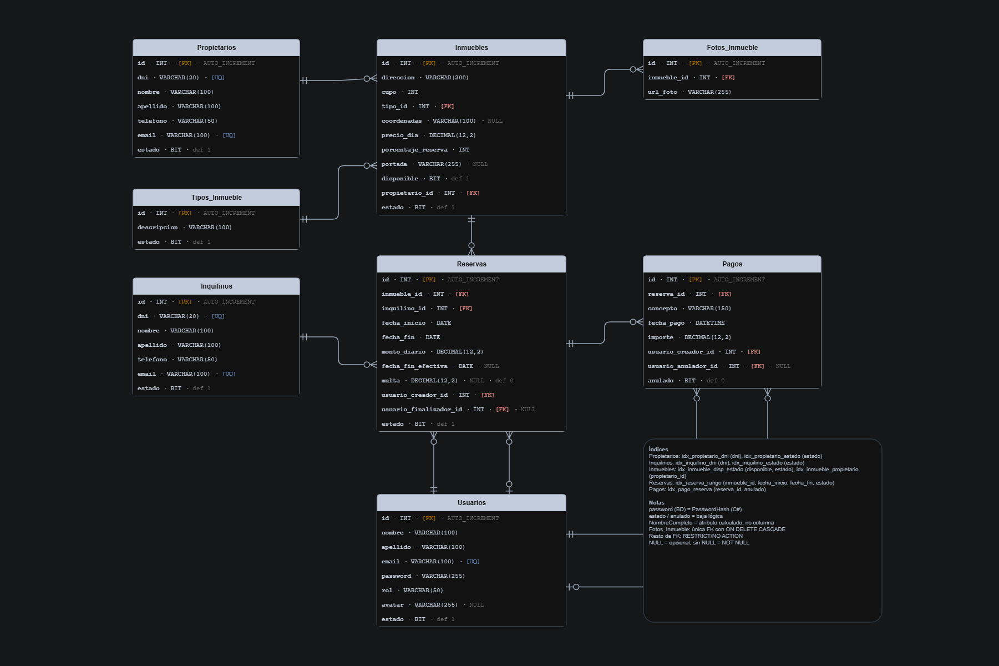
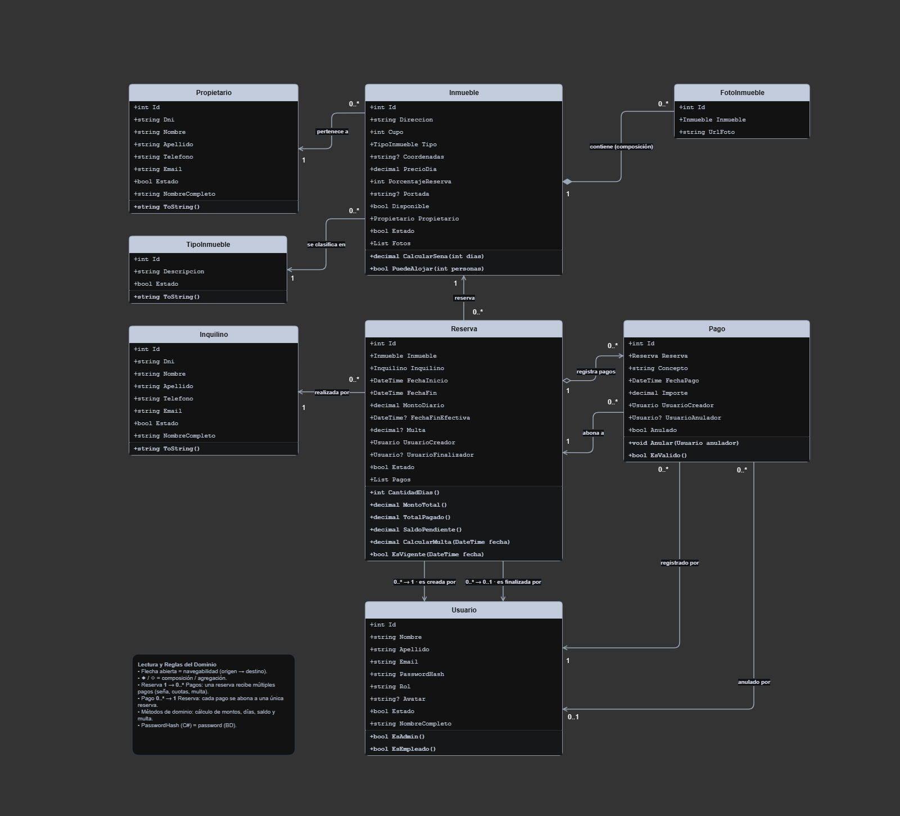

# Sistema de Gestión Inmobiliaria - Reservas Temporales

> Aplicación web desarrollada en ASP.NET Core (.NET 10) MVC con MySQL para la gestión integral de alquileres temporarios, propietarios, inquilinos, inmuebles, reservas y cobro de pagos con doble auditoría.

---

## Integrantes del Grupo

* **Exequiel Muñoz** - *boschieze6@gmail.com* - [@exeqm1](https://github.com/eexeqm1)

---

## Credenciales de Acceso (Usuarios de Prueba)

El sistema cuenta con autenticación basada en cookies y roles (*Administrador* y *Empleado*), con contraseñas encriptadas mediante PBKDF2 (SHA-256 con 100.000 iteraciones).

Para ingresar y evaluar el sistema, se incluyen las siguientes cuentas iniciales:

| Rol | Correo Electrónico | Contraseña | Permisos / Alcance |
| :--- | :--- | :--- | :--- |
| **Administrador** | `admin@inmobiliaria.com` | `admin123` | Acceso total: gestión de usuarios, auditoría, anulación de pagos, reportes y configuración. |
| **Empleado** | `empleado@inmobiliaria.com` | `empleado123` | Operación diaria: gestión de propietarios, inquilinos, inmuebles, reservas y registro de pagos. |

*(Nota: En la pantalla de inicio de sesión también figuran las cuentas de demostración al pie del formulario).*

---

## Modelado y Diseño del Sistema

A continuación se presentan los esquemas y diagramas correspondientes a la aplicación según la narrativa y reglas de negocio del sistema:

### 1. Diagrama Entidad-Relación (DER)
Representa la estructura física y lógica de la base de datos relacional MySQL, con notación Crow's Foot estricta.



*Archivo fuente editable: [`docs/diagrama-er.drawio`](docs/diagrama-er.drawio)*

---

### 2. Diagrama de Clases UML (Dominio Enriquecido)
Representa el modelo orientado a objetos en memoria (C#), con propiedades calculadas, métodos de dominio (`CalcularMulta`, `SaldoPendiente`, `TotalPagado`, `CantidadDias`), tipos de C#, navegabilidad y multiplicidades de asociación.



*Archivo fuente editable: [`docs/diagrama-clases.drawio`](docs/diagrama-clases.drawio)*

---

## Esquema de Entidades (MySQL)

```
PROPIETARIOS ||--o{ INMUEBLES : posee
TIPOS_INMUEBLE ||--o{ INMUEBLES : clasifica
INQUILINOS ||--o{ RESERVAS : solicita
INMUEBLES ||--o{ RESERVAS : incluye
INMUEBLES ||--o{ FOTOS_INMUEBLE : contiene
RESERVAS ||--o{ PAGOS : genera
USUARIOS ||--o{ RESERVAS : gestiona (creador / finalizador)
USUARIOS ||--o{ PAGOS : registra / anula
```

---

## Instrucciones para Levantar la Base de Datos

Para inicializar la base de datos a partir del script SQL provisto en este repositorio, sigue estos pasos:

1. **Abrir el gestor de base de datos:**
   Inicia tu gestor preferido (MySQL Workbench, phpMyAdmin, DBeaver o la consola de MySQL).

2. **Cargar el script:**
   Abre el archivo [`database.sql`](database.sql) ubicado en la raíz del repositorio.

3. **Ejecutar las sentencias:**
   Ejecuta el script completo. La instrucción `CREATE DATABASE IF NOT EXISTS inmobiliaria_db;` creará el esquema y generará las tablas correspondientes junto con las claves foráneas, índices y todos los datos iniciales de prueba (usuarios, tipos de inmuebles, propietarios, inmuebles y reservas).

4. **Verificación:**
   Comprueba que la base de datos `inmobiliaria_db` contenga las tablas creadas y listas para operar con la aplicación.
